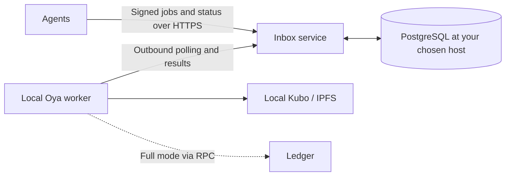

# Oya production node

The default deployment runs Oya and Kubo on your local device, with a portable PostgreSQL inbox receiving external messages. Agents submit signed jobs over HTTPS; the local worker polls with outbound requests, publishes to IPFS, optionally records the CID in Ledger, and reports the result. PostgreSQL retains queued messages and execution checkpoints through disconnects and worker restarts. You choose where to host the inbox and database.

Start with [Run a live node locally](run-locally.md) and [Host the PostgreSQL inbox](host-inbox.md). They use the published [node-v0.3.0 image and matching bundle](release-image.md#published-deployment-release) and cover IPFS-only and full Ledger modes, signing keys, monitoring, offline delivery, and recovery. No source build is required; native source builds remain an option. The [inbox API](inbox-api.md) defines signed jobs, status, leases, and transaction checkpoints. v0.2.0 images support only the direct API.



The remaining sections document the **advanced synchronous HTTP runtime** and shared configuration/contract tools. For existing released local installations, see [direct HTTP setup](run-direct.md). A direct node accepts signed text and returns `200 / published` in IPFS mode or `200 / logged` after Ledger receipt verification; it has no durable inbox. Do not run it concurrently with a worker using the same node signing account.

After signature, allowlist, and request-limit checks, the HTTP handler calls the kernel's `publishSignedMessage` in IPFS mode or `publishAndLogSignedMessage` in Ledger mode. One complete operation runs at a time. Additional authenticated requests within the request budget receive `503 node_busy`; there is no waiting queue.

The Ledger runtime installs the published `@oyaprotocol/ethereum` and `@oyaprotocol/messages` kernels at `0.2.0`, with `@oyaprotocol/ipfs` at `0.1.2` and `@oyaprotocol/utils` at `0.1.1`, and uses ethers in `src/signer.mjs` for local transaction signing. Ethereum and messages are updated together to keep one Ethereum package instance for error classification. The kernels handle publication, transaction preparation, broadcasting, and receipt verification. Kernel signing support remains future work. Reimbursement verification, Safe proposals, and DeFi actions are later integrations.

When upgrading an existing local instance, rename `loggerContract` to `ledgerContract` in its config and deployment record, and `LOGGER_DEPLOYER_PK` / `LOGGER_CHAIN_ID` to `LEDGER_DEPLOYER_PK` / `LEDGER_CHAIN_ID` where used. Use `deploy-ledger` for deployment/reuse. The existing contract address remains valid because the ABI is unchanged. Private settings and prior deployment artifacts are not rewritten automatically.

## IPFS-only configuration

Set `"mode": "ipfs"` to publish and pin signed messages without an RPC endpoint, Ledger contract, funded node account, or gas fees. Agents still need message-signing keys. For a Docker worker or direct node, use this private `node.json`, replacing the signer placeholder:

```json
{
  "mode": "ipfs",
  "host": "0.0.0.0",
  "port": 8787,
  "allowedSigners": ["0x2222222222222222222222222222222222222222"],
  "ipfsUrl": "http://ipfs:5001"
}
```

Supply a readable private `node.env` file; it can be empty with the bundled Kubo service. If the IPFS API needs authentication, set only `OYA_IPFS_AUTHORIZATION`. Node-key and RPC secrets are unused in this mode. Keep the same Docker mount and file-permission setup below. Startup requires a nonempty allowlist.

For a host process, set `host` to `127.0.0.1` and `ipfsUrl` to your host-reachable Kubo API. The local `check`, `run`, and `status` commands support this mode with an empty selected environment file. `check` probes only IPFS, and `deploy-ledger` refuses IPFS mode before any deployment or RPC request.

Omitting `mode` preserves Ledger behavior; `"mode": "ledger"` selects it explicitly. IPFS mode rejects the Ethereum-only settings `chainId`, `ledgerContract`, `rpcUrl`, `receiptTimeoutMs`, `pollIntervalMs`, `gasLimit`, and `maxFeePerGasWei`; remove those fields instead of leaving placeholders. HTTP limits and `operationTimeoutMs` work in both modes.

An IPFS success has this shape:

```json
{
  "status": "published",
  "signer": "0x...",
  "publication": { "status": "published", "cid": "bafk...", "uri": "ipfs://bafk..." }
}
```

The result confirms the configured IPFS API accepted and pinned the signed bytes; it does not create an onchain record or prove retrieval from an independent peer. Upload failures and timeouts return sanitized errors with `started: true`, without `loggingOutcome` or transaction fields. Content may already have been uploaded, but subsequent requests can proceed without restarting. The same one-operation limit, request budget, signature checks, and shutdown draining apply. There is no new automatic retry or restart policy.

This mode is available in `node-v0.2.0`; `node-v0.1.0` does not support it. Use matching image and deployment files from a release containing this mode. When changing an existing Ledger node to IPFS mode, first drain work and reconcile any uncertain Ledger transaction, then deliberately restart with the new configuration.

## Run with Docker Compose

The default [local worker walkthrough](run-locally.md) uses `inbox/compose.worker.yaml`. The manual workflow below uses the synchronous `compose.yaml` for local-only clients or advanced direct deployments. Its optional hourly testing profile is documented in the [direct setup guide](run-direct.md). Maintainers use the [image release guide](release-image.md) to publish tagged revisions and matching bundles.

[compose.yaml](compose.yaml) runs the node and Kubo with persistent IPFS storage. Use a Linux Docker host or Docker Desktop with Linux containers, and Compose 2.30 or newer. Run the commands below from the repository root. In Ledger mode, Ethereum comes from your selected RPC provider; deploy or verify Ledger and fund a dedicated node account before starting the node. In IPFS mode, use the configuration above and skip Ledger deployment and funding.

### Prepare private settings

For a new instance, replace the placeholder directory below with an absolute path outside the checkout. Keep the Compose project name stable: `oya` owns the `oya_ipfs-data` volume.

```sh
umask 077
mkdir -m 700 /absolute/path/to/private-oya
export OYA_CONFIG_FILE=/absolute/path/to/private-oya/node.json
export OYA_ENV_FILE=/absolute/path/to/private-oya/node.env
export OYA_CONTAINER_USER="$(id -u):$(id -g)"
export COMPOSE_FILE=node/production/compose.yaml
export COMPOSE_PROJECT_NAME=oya
cp -n node/production/docker/config.example.json "$OYA_CONFIG_FILE"
cp -n node/production/docker/runtime.env.example "$OYA_ENV_FILE"
chmod 600 "$OYA_CONFIG_FILE" "$OYA_ENV_FILE"
```

Edit both files before continuing. The copied example selects Ledger mode and its chain, RPC URL, Ledger address, and allowed signer address are placeholders. Select your chain and RPC, verified Ledger address, and actual agent allowlist, or replace the JSON with the IPFS-only example above. Keep the internal `host` as `0.0.0.0`, `port` as `8787`, and `ipfsUrl` as `http://ipfs:5001`. Container loopback addresses refer to that container, so an RPC running elsewhere needs an address reachable from Docker.

The secret file accepts only `OYA_NODE_PRIVATE_KEY` and optional complete `OYA_RPC_AUTHORIZATION` / `OYA_IPFS_AUTHORIZATION` headers. Only Ledger mode requires the node key; IPFS mode permits an empty file. It keeps the `node.env` filename but is mounted read-only at `/run/secrets/node.env`, not injected through Compose's `env_file`. Use literal, unquoted `KEY=value` lines, with no inline comments or duplicate keys. Blank lines and lines beginning with `#` are allowed. Dollar signs, quotes, spaces, and `=` in values remain literal. Leave authorization values empty or omit them when unused; the bundled Kubo API requires none. Keep agent and Ledger-deployer keys in separate files for their separate tools.

Startup and deployment validation read the same file directly into application settings, without copying its values to `process.env` or falling back to inherited secrets. Missing/unreadable files and malformed/unknown entries fail with sanitized errors. Secret values stay out of Docker's configured environment and expanded Compose model. The host file and application memory still contain them: read-only mounting does not encrypt data or protect it from the application, host root, or Docker administrators.

The default container user is `1000:1000`. On a POSIX host, the override above selects the current operator's UID/GID; run it as a non-root user. Both mode-0600 files need a matching owner, or deliberately configured group access: the container reads both the JSON and the secrets file. On Windows, set the same variables in your shell using absolute host paths and an explicit numeric `OYA_CONTAINER_USER`, such as `1000:1000`, and restrict access with host ACLs. Docker Desktop file sharing can differ from Linux ownership; verify the actual mounts below before startup. Do not make private files world-readable to fix access.

```sh
docker compose config --quiet
docker compose build node
docker compose run --rm --no-deps --entrypoint node node -e 'for (const path of ["/config/node.json", "/run/secrets/node.env"]) require("node:fs").readFileSync(path); console.log("Private files are readable")'
```

`config --quiet` checks the Compose model without printing deployment details. The mount check confirms file access; application startup validates the JSON, secret entries, and signer. A missing input path fails instead of creating a directory. Re-export these variables in a new terminal before using the remaining commands.

If Ledger still needs deployment, use the existing [deployment workflow](#deploy-or-reuse-ledger) with host Node.js/npm and Foundry. Prepare a separate host-facing config with `host: "127.0.0.1"`, a host-reachable RPC URL, and the same chain; put only the deployer key in its environment file. The local CLI rejects the container's `0.0.0.0` bind. Preview and then explicitly broadcast:

```sh
npm --prefix node/production run local -- deploy-ledger --config /absolute/path/to/private-oya/deploy.json --env-file /absolute/path/to/private-oya/deployer.env
npm --prefix node/production run local -- deploy-ledger --broadcast --config /absolute/path/to/private-oya/deploy.json --env-file /absolute/path/to/private-oya/deployer.env
```

Broadcast spends funds on the selected chain. Adopt the verified address manually in both configs. Deployment with custom RPC Authorization headers is unsupported. Starting Compose never deploys Ledger, creates a node key, or funds accounts.

### Operate and inspect

```sh
docker compose up -d
docker compose ps
docker compose logs --follow node
```

Stopping log-following leaves services running. Node HTTP is published at `http://127.0.0.1:8787`; `OYA_HTTP_PORT` changes only the host port. Kubo's TCP/UDP swarm port 4001 is published on the host, while API 5001 and gateway 8080 remain unpublished. The node reaches Kubo's API over their shared `backend` network. For agents on other machines, use the [optional HTTPS proxy](#receive-messages-over-https). Check Kubo peer connectivity and retrieval from an independent peer before relying on public availability:

```sh
docker compose exec ipfs ipfs swarm peers
```

The node waits for Kubo's API health check before startup. Node health reports local lifecycle state: ready and busy are healthy; shutdown and Ledger-mode unknown transaction outcomes are unhealthy. It does not continuously test Ethereum or IPFS. Both services rotate logs at 10 MB per file with three files retained. Kubo can restart automatically; the node retains `restart: "no"` in both modes. In Ledger mode, restarting clears the in-memory unknown-outcome guard: reconcile uncertain transactions first and run only one instance per node account.

From a separate terminal with host Node.js and the installed `node/production` dependencies, use the [existing sender](#submit-a-message) with only the agent key loaded. Substitute your text file and returned CID:

```sh
node --env-file=/absolute/path/to/agent.env -- node/production/scripts/send-message.mjs http://127.0.0.1:8787 /absolute/path/to/message.txt
docker compose exec ipfs ipfs pin ls --type=recursive
docker compose exec ipfs ipfs cat /ipfs/REPLACE_WITH_RETURNED_CID
```

Stop admission and drain accepted work before replacing the node or updating its settings. When using the HTTPS overlay, follow its [shutdown procedure](#receive-messages-over-https) first:

```sh
docker compose stop node
docker compose up -d --no-deps --force-recreate node
```

For an image update, preserve the previous image ID for rollback and run `docker compose build node` between these commands. Recreation reloads changed configuration and secret files and refreshes bind mounts after atomic file replacement; it also applies changed service environment. The node has a four-minute stop grace for its default three-minute operation deadline. Increase `OYA_STOP_GRACE_PERIOD` with headroom if you increase `operationTimeoutMs`. In Ledger mode, a forced shutdown or missing client response requires transaction reconciliation before another start.

`docker compose down` stops services in dependency order and retains the named IPFS volume. Keep the same project name when bringing them back. `down --volumes` deletes the repository. An image moved to another host does not carry its volume or private settings.

### Receive messages over HTTPS

[docker/compose.http.yaml](docker/compose.http.yaml) adds [Caddy 2.11.4](https://hub.docker.com/_/caddy), pinned by its Linux multi-platform image digest. The [Caddyfile](docker/Caddyfile) forwards `/v1/messages` to the node, preserving the method, signed body, response status, and `Retry-After`. Other HTTPS paths return 404, including `/healthz`. The node's host port stays on loopback, and Kubo's API/gateway stay unpublished. HTTP/1.1 and HTTP/2 use TCP; HTTP/3 is disabled.

Caddy and the node share a `frontend` network; only the node joins both `frontend` and `backend`. Caddy cannot connect directly to Kubo's API. Both networks retain outbound connectivity for certificates, RPC calls, and IPFS peers.

Choose a public DNS hostname you control. Point its A record, and any AAAA record, to this Docker host; remove an AAAA record if IPv6 is not routed to it. Allow inbound TCP 80 and 443 through the host/cloud firewall and any router forwarding, and ensure those ports are free. Caddy needs outbound DNS and HTTPS access to obtain and renew certificates. Keep port 80 reachable for HTTP redirects and certificate validation. Clients should submit directly to HTTPS. See [Caddy's automatic HTTPS requirements](https://caddyserver.com/docs/automatic-https).

Keep the private config/environment paths and Compose project name from the setup above. Set `allowedSigners` in the node's JSON to the addresses of authorized users and agents; each client keeps its own signing key. Use a hostname only in `OYA_PUBLIC_HOSTNAME`, without a scheme, path, or port. These proxy inputs belong in the shell used by Compose, not in the node's runtime environment file.

Before starting or recreating services, compare their deadlines:

| Setting | Default | Required relationship |
| --- | --- | --- |
| `operationTimeoutMs` in node JSON | `180000` (3 minutes) | Bounds the complete publication operation. |
| `OYA_PROXY_RESPONSE_TIMEOUT` | `4m` | At least `operationTimeoutMs + 60000` milliseconds. |
| `OYA_PROXY_STOP_GRACE_PERIOD` | `5m` | At least one minute longer than the proxy response timeout. |
| `OYA_STOP_GRACE_PERIOD` | `4m` | At least `operationTimeoutMs + 60000` milliseconds. |

The proxy waits for the node's response headers for `OYA_PROXY_RESPONSE_TIMEOUT`; its shutdown drain uses that same duration. For example, a five-minute operation timeout (`300000`) requires at least `6m`, `7m`, and `6m` for the three environment settings above, respectively. These comparisons are an operator preflight requirement: Compose and Caddy syntax validation do not compare their durations against the private node JSON. Accepted node work continues after a client disconnects, so every proxy or load balancer in front of it needs sufficient response time. [Caddy documents the response deadline](https://caddyserver.com/docs/caddyfile/directives/reverse_proxy) and [shutdown grace](https://caddyserver.com/docs/caddyfile/options#grace-period).

After DNS, networking, and timeout checks, run from the repository root:

```sh
export OYA_PUBLIC_HOSTNAME=node.example.com
export OYA_PROXY_RESPONSE_TIMEOUT=4m
export OYA_PROXY_STOP_GRACE_PERIOD=5m
export OYA_STOP_GRACE_PERIOD=4m
export COMPOSE_FILE=node/production/compose.yaml:node/production/docker/compose.http.yaml
docker compose config --quiet
docker compose run --rm --no-deps proxy caddy validate --config /etc/caddy/Caddyfile --adapter caddyfile
docker compose up -d --build
docker compose ps
docker compose logs --follow proxy
```

Replace the hostname and adjust the durations before running. On Windows, separate `COMPOSE_FILE` entries with `;`, or pass both files in order with `-f` on each Compose command. Keep the overlay selected for subsequent lifecycle commands. `config --quiet` avoids printing the node's credentials; Caddy validation checks its own configuration without opening public listeners. Successful validation does not prove public DNS or certificate issuance.

Caddy obtains and renews certificates automatically. The project's `caddy-data` volume stores certificates and private keys; `caddy-config` retains Caddy configuration state. Preserve both across recreation and ordinary `down`/`up`, protect any backups, and retain the project name. The proxy can restart independently; the signing node still requires deliberate recovery. Access logging is disabled, request metadata is removed from proxy error logs, and Docker rotates proxy logs at 10 MB with three files retained. Do not enable debug or request-body logging for normal operation.

From another machine with Node 24 and the installed sender dependencies, submit directly to your HTTPS hostname:

```sh
node --env-file=/absolute/path/to/agent.env -- node/production/scripts/send-message.mjs https://node.example.com /absolute/path/to/message.txt
```

The private client file contains `OYA_AGENT_PRIVATE_KEY`; its address must be allowlisted by the node. The sender signs locally and sends the existing signed envelope. Only valid allowlisted requests count toward the shared message limit. HTTP 429 includes the wait in `Retry-After`; HTTP 503 `node_busy` means another operation is active. Deliberately submitting the same message again remains valid and can create another Ledger transaction. Proxy retries and upstream connection reuse are disabled. After a missing response or uncertain outcome, reconcile the transaction before retrying. The initial workflow supports HTTP clients; browser clients hosted on another origin need a separate CORS policy.

To withdraw public access, or before replacing the node, stop the proxy first and allow its requests to drain while the node and Kubo are still running:

```sh
docker compose stop proxy
docker compose stop node
```

After any required reconciliation and settings/image updates, restart the node with `docker compose up -d --no-deps --force-recreate node`, then run `docker compose up -d proxy`; its dependency check waits for node health. To change proxy settings or its image, stop it and use `docker compose up -d --force-recreate proxy`. The Caddy admin API is disabled, so apply changes by recreation. For a complete shutdown, `docker compose down` respects the proxy → node → Kubo dependencies and keeps the volumes; `down --volumes` also deletes certificate state. Stop the proxy before the IPFS backup procedure below, and use the same merged configuration when bringing the stack back.

Milestone 5 validation on Linux arm64 with Engine 27.4.0 and Compose 2.31.0 checked the merged model and Caddy configuration at four- and six-minute proxy deadlines. A disposable HTTP upstream and locally trusted test certificate verified HTTPS, redirects, blocked routes, exact message forwarding, statuses and `Retry-After`, log filtering, a single attempt on upstream failure, and a twelve-second response drained during Compose shutdown. The test trusted its CA only in the client process. The [HTTPS integration fixture](#validate-the-https-flow) adds real signed publication; public DNS, public certificate issuance, and reachability from another machine require the separate operator check below.

### Back up and restore IPFS

Back up the complete Kubo repository while both services are stopped. The archive contains Kubo's private identity as well as content and pins; protect it and keep an off-host copy. Back up node config/key files separately. Choose a new backup filename and retain the exact image versions with it. Record the peer identity before stopping:

```sh
docker compose exec -T ipfs ipfs id -f='<id>\n'
docker compose stop node ipfs
export OYA_BACKUP_FILE=/absolute/path/to/private-oya/ipfs-repo.tar
umask 077
docker compose run --rm --no-deps -T --entrypoint tar ipfs -C /data/ipfs -cpf - . > "$OYA_BACKUP_FILE"
```

Require a successful archive command before relying on the backup. Restore into a fresh volume by choosing a new, unused Compose project name (`oya-restore` below). These one-off containers use the pinned Kubo image and do not start a daemon or publish service ports:

```sh
docker compose -p oya-restore run --rm --no-deps -T --entrypoint tar ipfs -C /data/ipfs -xpf - < "$OYA_BACKUP_FILE"
docker compose -p oya-restore run --rm --no-deps -T --entrypoint ipfs ipfs --offline id -f='<id>\n'
docker compose -p oya-restore run --rm --no-deps -T --entrypoint ipfs ipfs --offline pin ls --type=recursive
docker compose -p oya-restore run --rm --no-deps -T --entrypoint ipfs ipfs --offline cat /ipfs/REPLACE_WITH_RETURNED_CID
```

Compare the restored identity, pins, and message bytes with the original before adopting the backup. To resume the original stack, use `docker compose up -d`. To adopt the restored repository instead, keep the original services stopped, set `COMPOSE_PROJECT_NAME=oya-restore`, and start with the same node settings and key after reconciling pending work. Do not run both signing nodes. Upgrade Kubo separately from the node and take a cold backup first; an image downgrade alone does not undo repository-format changes.

Milestone 2 validated mounted settings, health probes, persistence, and the cold backup/restore commands above on Linux arm64 through Docker Desktop 4.37.2 / Engine 27.4.0 and Compose 2.31.0. Milestone 3 adds the reproducible signed-publication and lifecycle test below.

### Validate the Docker flow

For the default inbox/local-worker deployment, build the Ledger fixture with `forge build --root contracts`, then run `npm --prefix node/production run test:inbox` and `npm --prefix node/production run test:inbox:docker`. They exercise real PostgreSQL persistence, claims and recovery, plus both packaged worker modes through HTTPS with Kubo and Anvil. Tests use disposable resources and do not publish images or use real-chain funds. The checks below retain coverage for the advanced direct API.

Use Node 24, host Foundry, a reachable Linux Docker daemon, and Compose 2.30+. Run from the repository root:

```sh
git submodule update --init lib/forge-std
npm --prefix node/production ci --ignore-scripts
forge build --root contracts
npm --prefix node/production run test:docker -- --verbose
```

Every run builds the image from the repository's Dockerfile and locked dependencies; Docker may reuse unchanged build layers. The harness starts its own Anvil and offline Kubo containers, deploys Ledger with the existing local CLI, and runs the existing sender in a separate process. Host Kubo and Anvil installations are unnecessary. The [test override](docker/compose.test.yaml) pins Foundry 1.5.1 by its multi-platform image digest and replaces production ports with dynamically allocated loopback ports, including a test-only Kubo API port. No swarm or gateway port is published by the fixture.

The test checks exact signed IPFS bytes and Ledger events, disallowed and busy requests, identity/content/pin persistence after container recreation, and absence of startup transactions. It holds a transaction pending for more than ten seconds during Docker SIGTERM, then verifies successful publication and a clean exit. A separate receipt timeout must leave the node unhealthy without restarting; the harness mines and verifies that transaction before deliberately restarting. Finally it restores a cold IPFS backup into a fresh volume and checks identity, content, pins, and config ownership/mode.

All accounts and settings are generated for the disposable chain. The harness removes its own containers, volumes, image tag, and private files on completion, failure, or handled interruption. Output contains public verification evidence; child-process output and the private backup stay within the fixture. `--verbose` prints stages, CIDs, and transaction hashes. Polls and subprocesses are bounded, with a 15-minute test deadline. The original host tests remain independently runnable.

The default platform matches the Docker daemon. To exercise the other image architecture when your daemon supports emulation, add `--platform linux/amd64` or `--platform linux/arm64`. The result reports both the selected image platform and daemon architecture. CI runs the amd64 flow on Ubuntu and separately cross-builds the arm64 image with Buildx without publishing it. Cross-building does not establish native execution; see the [execution plan](../../plans/docker-node-runtime-execplan.md) for recorded results and outstanding platform checks.

Validation on 2026-09-15 used Docker Desktop 4.37.2 / Engine 27.4.0, Compose 2.31.0, host Node 24.21.0, Foundry 1.5.1, and Kubo 0.43.0:

| Image platform | Result |
| --- | --- |
| Linux arm64 | Complete flow passed natively on the arm64 Docker daemon; separate Buildx OCI image export passed. |
| Linux amd64 | Complete flow passed under emulation on the same arm64 daemon. |

Hosted CI results, native Linux host permissions, and Windows file sharing remain unverified here.

### Validate the HTTPS flow

After the same Node 24, Foundry, dependencies, and Docker prerequisites above, run:

```sh
npm --prefix node/production run test:http -- --verbose
```

This runs the existing Docker harness with `--http`, adding the production HTTPS overlay and [its fixture override](docker/compose.http.test.yaml). It builds the repository image, generates separate deployer/node/agent accounts, and starts Anvil, offline Kubo, and Caddy 2.11.4. All published fixture ports use dynamically allocated host-loopback bindings. The test-only IPFS API mapping supports independent content checks; production configuration is inspected separately to ensure its API/gateway remain unpublished and its node port remains on loopback.

Caddy issues a certificate for `localhost`. The fixture exports only its public root certificate to the test clients, verifies that a client without that trust rejects the certificate, and uses the existing sender in a separate process. TLS verification stays enabled; host trust stores are untouched. Cleanup removes the fixture's containers, volumes, certificate data, and generated settings. Only public publication evidence is printed.

The flow verifies exact signed IPFS bytes and Ledger events, repeated identical messages with the same CID and distinct transactions, malformed/disallowed signatures, body/text limits, HTTP 429 and recovery after `Retry-After`, and busy responses. It also checks HTTPS route isolation, HTTP redirects, and the absence of extra transactions. Shutdown drains accepted work with both default deadlines and five-minute operation/receipt deadlines paired with a six-minute proxy response/drain and seven-minute proxy stop grace. The longer case holds a transaction pending for 245 seconds after proxy shutdown starts, then mines it and requires the successful response to reach the sender before both containers exit normally.

The HTTPS fixture has a twenty-minute overall deadline and normally needs several minutes, including the deliberate rate-limit reset and four-minute wait. `--platform linux/amd64` or `--platform linux/arm64` selects the image architecture, as with `test:docker`. CI runs both modes on amd64 and retains the arm64 image cross-build. The original `test:docker` remains the dedicated persistence, unknown-outcome reconciliation, and backup/restore check.

Validation on 2026-09-21 passed the HTTPS flow in about 347 seconds on native Linux arm64 through Docker Desktop / Engine 27.4.0, Compose 2.31.0, Node 24.21.0, Foundry 1.5.1, Kubo 0.43.0, and Caddy 2.11.4. The original internal Docker flow and all 94 host tests also passed. This milestone's HTTPS flow has not been run on amd64 here; its hosted CI result remains unverified.

### Validate IPFS-only operation

With Node 24 and Docker/Compose, run from the repository root:

```sh
npm --prefix node/production run test:ipfs -- --verbose
```

This builds the working tree image and runs disposable Kubo, HTTPS, node, and hourly-agent containers with an empty node secrets file and no Ethereum service. It checks exact signed content retrieval, authorization, repeated publication, IPFS outage recovery, persistent IPFS identity/content after container replacement, and the agent's first `test_message_published` event. It also runs the agent module tests. Add `--platform linux/amd64` to validate the release image architecture. No Foundry, funded accounts, public DNS, or cloud deployment is involved; the fixture cleans up its own containers and volumes.

### Validate the hourly testing profile

With the same Docker, Node 24, and Foundry prerequisites, run from the repository root:

```sh
npm --prefix node/production run test:testing -- --verbose
```

This builds the runtime image, runs the agent's module tests inside it, then initializes and starts the real `testing` profile against disposable Anvil and Kubo. It verifies the first message's signature, exact IPFS bytes, Ledger event, private mounts, network separation, disabled-profile behavior, and clean shutdown. Module tests use a controlled clock to verify the one-hour interval without waiting an hour. Add `--platform linux/amd64` to check the release image architecture. No cloud credentials, funded testnet accounts, or public image publication are involved.

### Check a deployed node from another machine

The local fixture does not prove public DNS, publicly trusted certificates, or live external reachability. That check remains pending an operator-owned deployment, hostname, and authorized client. After configuring the [HTTPS service](#receive-messages-over-https), run the existing sender from a different machine with its own key:

```sh
node --env-file=/absolute/path/to/agent.env -- node/production/scripts/send-message.mjs https://node.example.com /absolute/path/to/message.txt
curl -i --max-time 10 https://node.example.com/healthz
nc -vz -w 5 node.example.com 443
nc -vz -w 5 node.example.com 8787
nc -vz -w 5 node.example.com 5001
nc -vz -w 5 node.example.com 8080
```

Replace the hostname and files, and substitute the configured node host port if it differs from 8787. Require a `published` result in IPFS mode or `logged` in Ledger mode, and independently verify the IPFS bytes; Ledger mode also requires receipt/event verification. The health path must return 404, HTTPS port 443 must connect, and the node/IPFS API/gateway probes must fail. Check each configured IPv4/IPv6 address so an unused DNS record does not hide an exposed listener. Record the UTC time, public hostname, publication CID (and transaction hash in Ledger mode), and HTTP/port results without credentials or private client paths. Deliberate repeat submissions remain valid; reconcile any uncertain Ledger outcome before retrying.

## Install and validate

Use Node 22 or newer, npm, Foundry, and [Kubo 0.43.0](https://github.com/ipfs/kubo/releases/tag/v0.43.0) for the local integration tests. Both integration scripts require `ipfs` on `PATH` to report exactly `0.43.0`, matching Compose, and check the fixture daemon's version. Select that release on `PATH` before running them; a mismatch fails before any services start. CI uses Node 24. From the repository root:

```sh
git submodule update --init lib/forge-std
npm --prefix node/production ci
npm --prefix node/production test
forge build --root contracts --sizes
forge test --root contracts --offline -vv
ipfs version --number # Must print 0.43.0.
npm --prefix node/production run test:local
npm --prefix node/production run smoke:local
```

`test:local` exercises the operating commands with a disposable Anvil chain and an isolated offline Kubo repository. It simulates and deploys Ledger, checks the deployment record, adopts the address in its config as an operator would, then runs `check`, launches the foreground node, and queries `status`. A separate process runs the existing message sender with its own agent key. The test retrieves the exact signed JSON from IPFS and independently checks the mined Ledger event. A disallowed agent is rejected without a node transaction.

To follow each stage as it runs, add `--verbose`:

```sh
npm --prefix node/production run test:local -- --verbose
```

Verbose output includes public addresses, message text, CIDs, transaction hashes, and verification/restart results. It does not print private keys or raw child-process output. Without the flag, the test prints its final result and evidence-file location.

The test stops the node with SIGINT, restarts with the same identity and Ledger, publishes a second message, and stops with SIGTERM. It verifies unchanged settings, no transaction merely from restarting, unreachable status after shutdown, and continued Ethereum/IPFS service availability until fixture cleanup. All accounts are generated; only the deployer and node receive test ETH. The fixture stops its services and removes temporary settings and private keys. It retains a separate public `evidence.json` containing addresses, CIDs, transaction hashes, and checks, and prints that file's location. Offline Kubo keeps test content local; the fixture does not use the operator's existing fork or IPFS repository.

The smoke starts isolated Anvil and offline Kubo processes on loopback ports, deploys Ledger through `contracts/script/DeployLedger.s.sol`, and exercises real signed HTTP requests. It retrieves each published envelope and checks the mined Ledger event, rejects invalid signatures, and rejects startup on a wrong chain or missing contract. With automining disabled, it checks busy rejection while exactly one transaction is pending. After mining, the rejected request succeeds; repeating an earlier completed message creates a separate Ledger event with the same CID. The smoke also starts the actual node CLI and verifies its health and signing address. It stops its services when finished and prints a temporary directory containing `evidence.json` and service logs.

Host tests cover failure, deadline, client-disconnect, and shutdown behavior using controlled transports, including proof that rejected requests invoke no publication or signing work. The real smoke checks that busy rejection submits no second transaction. All smoke accounts and gas balances are generated for its disposable local chain.

To leave a working local stack running:

```sh
npm --prefix node/production run smoke:local -- --keep-running
```

This prints the actual node URL, RPC URL, IPFS URL, Ledger address, and temporary artifact directory. That directory contains `config.json` and a `.env` with generated local node and agent keys, written with mode `0600`; the keys are not printed. The local chain is disposable, and offline Kubo makes content available through its local API only. Press Ctrl-C to stop all three services. For deployment-script details, see [`contracts/README.md`](../../contracts/README.md).

## Configure and start

Prepare dependencies and private configuration templates from the repository root:

```sh
npm --prefix node/production run local -- setup
```

Setup installs the host and published kernels from `node/production/package-lock.json` and creates missing `config.local.json` and `.env` files with mode `0600`. No kernel source build or TypeScript installation is needed. Repeating it preserves existing files and their permissions. It uses Node.js built-ins and needs Node 22 or newer and npm; it does not deploy Ledger or start services. Template addresses and empty keys must be filled before use. For different file locations, add `--config /absolute/path/to/node.json --env-file /absolute/path/to/node.env`; parent directories must already exist. Relative paths resolve from the directory where you invoked the command. Keep custom files outside the checkout or ignore them in Git.

Edit the ignored `config.local.json` (or copy `config.example.json` there when configuring manually). For IPFS mode, replace it with the [IPFS-only configuration](#ipfs-only-configuration), using a loopback host and host-reachable IPFS endpoint. For Ledger mode, replace the example Ledger and agent addresses with your deployment and allowlisted signer addresses, and set `chainId`, `rpcUrl`, and `ipfsUrl`. In both modes, `ipfsUrl` must be a Kubo-compatible API, with `/api/v0/add` support; a read-only gateway or unrelated pinning API is insufficient.

In Ledger mode, the node account must have gas funds and be dedicated to one runtime. The agent signing key is distinct; it does not need gas to sign a message. Store `OYA_NODE_PRIVATE_KEY` in the ignored `node/production/.env`, or inject it through your process supervisor. IPFS mode creates no node signer and needs no node key. Optional `OYA_RPC_AUTHORIZATION` and `OYA_IPFS_AUTHORIZATION` contain complete HTTP Authorization header values. Keep RPC URLs containing credentials in private local config too.

### Deploy or reuse Ledger

From the repository root, optionally preview deployment using the configured Ethereum connection:

```sh
npm --prefix node/production run local -- deploy-ledger
```

If `ledgerContract` already has code on the configured chain, the command reports reuse and changes no files. This checks code presence, not the contract's implementation. Otherwise, install Foundry and supply a funded deployment account through `LEDGER_DEPLOYER_PK` in the selected environment file or inherited environment. The command initializes `lib/forge-std` if missing and invokes the existing `contracts/script/DeployLedger.s.sol`; Forge compiles and simulates it. The node key, node balance, and a running IPFS service are not prerequisites for deployment.

To deploy, use `--broadcast`. Forge includes simulation in this command, so a separate preview is optional:

```sh
npm --prefix node/production run local -- deploy-ledger --broadcast
```

Both commands accept `--config <path>` and `--env-file <path>`, with the same file-first environment precedence as the other local commands. The selected chain and RPC endpoint are used by both the kernel checks and Forge. Deployment through RPC endpoints requiring Authorization headers is deferred; `deploy-ledger` rejects a nonempty `OYA_RPC_AUTHORIZATION`. The config must be readable, and its directory must be writable for deployment records and artifacts. `--broadcast` is rejected for all other actions.

On Etherscan-supported chains, add `--verify` alongside `--broadcast` and set `ETHERSCAN_API_KEY` in the selected private environment file. The helper records a successful deployment before running `forge verify-contract --watch`; an explorer failure exits with status 1 while preserving the deployment record. If the configured address already has code, it verifies that address without deploying. A missing API key stops the command before any deployment. Local Anvil deployments do not need this option.

A successful broadcast is checked against its receipt, deployer, contract address, chain, and deployed code before public deployment metadata is saved. The record goes into the ignored `node/production/deployment.local.json`; a custom config such as `settings.json` uses the sibling `settings.json.deployment.local.json`. The command leaves the config untouched and prints the verified Ledger address. Set `ledgerContract` to that address in the selected config, then run `local check` after funding the node and starting IPFS. After this manual update, repeating the deployment command reuses the configured address without another transaction.

Each deployment attempt uses a separate private `.oya-ledger-*` directory beside the config, printed for inspection and ignored by Git. After an uncertain broadcast, inspect those artifacts and reconcile the transaction before another attempt; the wrapper does not retry deployment or use `--resume`. If recording fails after the receipt check, the verified address remains in the output for manual adoption. Existing metadata with no code at the configured address blocks deployment until the operator reconciles the record and chain, including adopting a newly deployed address in the config. Run one deployment command at a time per configuration.

The [local integration test](#install-and-validate) checks deployment-key precedence, blocked redeployment before manual adoption, and reuse after adoption as part of the complete publication flow.

### Deploy Ledger on Sepolia

Use this procedure on your local computer with a reviewed source checkout, Node.js 24, npm, and [Foundry](https://getfoundry.sh/getting-started/installation). The deployment bundle does not include the contract source or local CLI. Run the commands from the repository root in Bash or zsh, stopping if any command fails. This targets **Ethereum Sepolia, chain ID `11155111`**, as listed in the [Sepolia network configuration](https://github.com/eth-clients/sepolia#metadata).

#### Prepare a private deployment directory

Install the locked dependencies and initialize the contract's dependency:

```sh
npm --prefix node/production ci --ignore-scripts --no-audit --no-fund
git submodule update --init lib/forge-std
forge --version
```

Choose a directory outside the checkout and outside shared or cloud-synced folders. The path below is an example; keep it selected in this terminal for the remaining commands:

```sh
set +x
umask 077
export OYA_SEPOLIA_DIR="$HOME/oya-private/sepolia-ledger"
mkdir -p "$OYA_SEPOLIA_DIR"
chmod 700 "$OYA_SEPOLIA_DIR"
```

#### Create and fund a dedicated testnet deployer

This creates a fresh wallet, writes its private key directly to a mode-0600 file, and prints only its public address. The key is never pasted into a command or copied through the clipboard. The subshell below leaves your terminal in the repository root:

```sh
(
  cd node/production || exit 1
  node --input-type=module <<'NODE'
import { writeFile } from 'node:fs/promises';
import { join } from 'node:path';
import { Wallet } from 'ethers';

const wallet = Wallet.createRandom();
await writeFile(join(process.env.OYA_SEPOLIA_DIR, 'deployer.env'),
    'LEDGER_DEPLOYER_PK=' + wallet.privateKey + '\nOYA_RPC_AUTHORIZATION=\n',
    { flag: 'wx', mode: 0o600 });
console.log('Sepolia deployer address: ' + wallet.address);
NODE
)
```

Run wallet creation once. It refuses to overwrite an existing `deployer.env`; preserve that file when continuing or retrying deployment. The empty authorization entry prevents an inherited RPC authorization header from affecting this workflow.

Request Sepolia ETH for the printed address using a faucet from [Ethereum's Sepolia faucet list](https://ethereum.org/en/developers/docs/networks/#sepolia). Give the faucet only the public address, never the private key or a recovery phrase. Confirm the balance on [Sepolia Etherscan](https://sepolia.etherscan.io/) before proceeding. Use this account only for testnet deployment; the node and message-signing clients use separate accounts.

#### Configure the Sepolia connection

Create a private configuration file without overwriting an existing one:

```sh
cp -n node/production/config.example.json "$OYA_SEPOLIA_DIR/deploy.json"
chmod 600 "$OYA_SEPOLIA_DIR/deploy.json"
```

In a trusted local editor, replace its contents with the JSON below and replace `REPLACE_WITH_SEPOLIA_RPC_ENDPOINT` with your provider's HTTPS URL for Ethereum Sepolia. Keep any API token in this private file. The deployment helper does not support providers requiring a separate HTTP Authorization header.

```json
{
  "host": "127.0.0.1",
  "chainId": 11155111,
  "ledgerContract": "0x1111111111111111111111111111111111111111",
  "allowedSigners": ["0x2222222222222222222222222222222222222222"],
  "rpcUrl": "https://REPLACE_WITH_SEPOLIA_RPC_ENDPOINT",
  "ipfsUrl": "http://127.0.0.1:5001",
  "receiptTimeoutMs": 180000
}
```

The two addresses are placeholders for this deployment-only configuration. IPFS, a node key, and actual client addresses are not needed for `deploy-ledger`. The helper checks the RPC chain ID before invoking Forge; the Solidity script checks it again before deployment.

#### Configure source verification

Create an API key in your [Etherscan account](https://etherscan.io/myapikey). In a trusted local editor, add this entry to the existing private `deployer.env`, replacing the placeholder with the API key and preserving the other entries:

```dotenv
ETHERSCAN_API_KEY=REPLACE_WITH_ETHERSCAN_API_KEY
```

Keep this key out of Git and command arguments. The helper passes it only to the verification process, which receives neither the deployer key nor the private RPC URL. Verification publishes the Ledger source and compiler settings on Etherscan; it submits no transaction and spends no Sepolia ETH. See [Etherscan's Foundry verification guide](https://docs.etherscan.io/contract-verification/verify-with-foundry).

#### Simulate, then deploy and verify

First simulate without submitting a transaction:

```sh
npm --prefix node/production run local -- deploy-ledger \
  --config "$OYA_SEPOLIA_DIR/deploy.json" \
  --env-file "$OYA_SEPOLIA_DIR/deployer.env"
```

Check that the output names your public deployer address and chain `11155111`, followed by `OK Simulation passed`. If it reports reuse instead, the configured address already has code: stop and establish whether it is the intended Ledger. Code presence alone does not verify the contract implementation.

After a successful simulation, submit the deployment and automatically verify its source. Deployment spends Sepolia ETH for gas:

```sh
npm --prefix node/production run local -- deploy-ledger --broadcast --verify \
  --config "$OYA_SEPOLIA_DIR/deploy.json" \
  --env-file "$OYA_SEPOLIA_DIR/deployer.env"
```

The helper first prints the transaction hash and `OK Verified Ledger` after checking the receipt's success, sender, created address, chain, and deployed code. It writes `deploy.json.deployment.local.json` beside your configuration, then submits source verification and waits for Etherscan's result. Full success prints `OK Source verified on Etherscan`. Check the contract's **Contract** tab on Sepolia Etherscan for verified source code.

If broadcasting times out or the receipt check fails, retain the private deployment artifacts and reconcile the transaction on Sepolia before another broadcast. A failed command can still have submitted a successful transaction. Do not delete the records or repeatedly retry to get past an error. If only Etherscan verification fails or times out, the confirmed deployment record remains saved: use the verification-only command below for that address. Do not redeploy to retry source verification.

#### Verify an already deployed Ledger

Use the same source revision and `contracts/foundry.toml` settings used for deployment. The current project selects Solidity `0.8.23`, optimizer enabled with `200` runs, and EVM target `paris`. Ledger has no constructor arguments. Run from the repository root and replace `REPLACE_WITH_LEDGER_ADDRESS` with your deployed contract's public address, available in the saved deployment record or successful deployment output.

This Bash/zsh command prompts for your Etherscan API key without echoing it or putting it in shell history. Paste the API key at the prompt, not into a command. It does not load `deployer.env` or require a wallet key or RPC URL. The subshell keeps the exported API key scoped to this invocation:

```sh
(
  set +x
  printf 'Etherscan API key: '
  IFS= read -r -s ETHERSCAN_API_KEY || exit 1
  printf '\n'
  export ETHERSCAN_API_KEY
  forge verify-contract --root contracts --chain 11155111 \
    --verifier etherscan --watch \
    REPLACE_WITH_LEDGER_ADDRESS src/Ledger.sol:Ledger
)
```

[`--watch`](https://getfoundry.sh/forge/reference/verify-contract/) waits for the verification result. After fixing an API-key or source/settings error, or allowing time for explorer indexing, repeating this verification-only command is safe and cannot deploy another contract. Verification makes the source inspectable; it is not a security audit.

#### Use the address in your node

Set `ledgerContract` in `deploy.json` to the verified address so future deployment commands recognize it. In the separate private `node.json` used for the [local worker](run-locally.md), set `chainId` to `11155111`, `ledgerContract` to that same address, your Sepolia RPC URL, and your actual `allowedSigners`. Keep Docker settings `host: "0.0.0.0"`, `port: 8787`, and `ipfsUrl: "http://ipfs:5001"`. Match the public execution identity in the inbox configuration.

Fund the separate node account with Sepolia ETH for message-publication gas. The running node does not need the deployer key: keep `deployer.env` on your local computer and put only the node's own key and supported authorization values in its `node.env` secret file.

The commands above keep the deployer key out of command arguments and shell history, and the helper captures raw Forge output. The key remains plaintext in `deployer.env` and is passed to Forge through its child-process environment while signing. File permissions do not protect it from your account or a machine administrator; use a trusted machine and encrypted storage/backups. Keep private files and raw deployment artifacts out of Git, release bundles, screenshots, and support messages. Public addresses and transaction hashes can be shared, but reveal which account made the deployment.

### Check and run the node

Check the configuration and services from the repository root:

```sh
npm --prefix node/production run local -- check
```

`check`, `run`, and `status` accept the same `--config` and `--env-file` overrides as setup and share one settings loader. The selected environment file must be readable; it may be empty in IPFS mode or when credentials are injected. Its values override inherited environment values, including explicitly empty values; omitted entries use the inherited environment. These local commands require `host` to be `127.0.0.1` or `::1`. Only Ledger mode creates a node signer.

In IPFS mode, the command checks only the Kubo `/api/v0/version` endpoint. Ledger mode first checks the Ethereum chain ID, nonempty code at the Ledger address, and a positive native-currency balance for the node. Each probe has a 10-second deadline, including response reading and any RPC retries. It prints public addresses when applicable and an `OK` for each passing probe, exits 0 when all pass, or stops with a sanitized `FAIL` and exit 1 at the first failure. It submits no transactions, uploads no content, and changes no files. Code presence does not verify Ledger's implementation, a positive balance does not guarantee sufficient gas for a particular transaction, and the IPFS probe does not prove publication permissions.

Start the node in the foreground from the repository root:

```sh
node -- node/production/scripts/local-node.mjs run
```

Use this direct Node.js command when configuring a process supervisor, with the repository root as its working directory. Send SIGINT/SIGTERM to that Node.js PID, which owns the HTTP server. Launching through npm introduces a shell whose signal forwarding can vary. The `--` separator keeps options such as `--env-file` with the script.

`run` loads the selected configuration and signer once, performs readiness checks, prints the local URL, and calls `startNode()` in the same process. Startup uses those loaded settings even if the files change during readiness; later edits take effect on the next explicit run. The runtime receives its configuration and signer directly, without copying the selected environment into `process.env`. No dependencies are installed and no services are deployed by `run`.

Ctrl-C in the owning terminal, or SIGINT/SIGTERM sent to the node, stops admission and waits for active work to drain. There is no forced shutdown timer or automatic restart. A clean stop exits 0; startup or shutdown failure exits 1. Supplied Ethereum/IPFS services keep running. Start another explicit `run` to restart the node after reconciling any uncertain transaction outcome.

In another terminal, using the same path overrides if any:

```sh
npm --prefix node/production run local -- status
```

`status` queries only the local `/healthz` endpoint, with a five-second deadline covering connection and response reading. It verifies the mode, and in Ledger mode also the chain ID, Ledger address, and node address against the selected settings. `ready` and `busy` exit 0. `shutting_down`, `transaction_outcome_unknown`, an identity/mode mismatch, an unreachable node, or malformed health data exit 1 with sanitized output. Status never starts or restarts a process and does not probe Ethereum or IPFS. An unknown Ledger transaction outcome requires inspection before restarting or retrying.

For direct runtime startup with the same literal secret-file format as Docker:

```sh
node node/production/src/main.mjs /absolute/path/to/config.json /absolute/path/to/node.env
```

The second argument selects a required secrets file. Its values stay out of `process.env`, and omitted credentials never inherit environment values. This literal format differs from the local CLI's dotenv parser: use the Docker example file and keep agent/deployer keys separate.

For compatibility, the one-argument entrypoint still supports environment variables already loaded by a host process supervisor:

```sh
node -- node/production/src/main.mjs /absolute/path/to/config.json
```

Both CLI paths use `startNode(config, signer, { handleSignals: true })` from `src/main.mjs`, which starts the HTTP server and enables shared lifecycle logs and SIGINT/SIGTERM handling. Programmatic callers omit `handleSignals` and use the returned runtime's `close()` method themselves. Signal listeners remain installed until accepted work has drained and are then removed.

Ledger startup checks the RPC chain and deployed Ledger bytecode before serving traffic. IPFS runtime startup loads settings without contacting Ethereum; use `local check` or Compose's Kubo health check to establish basic IPFS readiness. Configuration rejects unsupported fields. There is no state directory, publication journal, process lock, or startup replay.

`host` defaults to `127.0.0.1`, and `port` to `8787`. To host it remotely, use the direct runtime entrypoint, choose the binding explicitly, and provide HTTPS through your hosting environment. Other optional settings are:

| Setting | Default | Purpose |
| --- | --- | --- |
| `mode` | `ledger` | `ledger` publishes and logs a CID onchain; `ipfs` only publishes to IPFS. |
| `maxMessageRequestsPerMinute` | 60 | Maximum valid allowlisted message attempts per node in a fixed 60-second window. |
| `maxBodyBytes` | 16,384 | Maximum HTTP request body size. |
| `maxTextBytes` | 8,192 | Maximum signed text size. |
| `bodyTimeoutMs` | 10,000 | Deadline for reading the request body. |
| `receiptTimeoutMs` | 60,000 | Ledger only: deadline for observing a transaction receipt. |
| `operationTimeoutMs` | 180,000 | Overall deadline for publication and any Ledger logging. |
| `pollIntervalMs` | 1,000 | Ledger only: interval between receipt polls. |
| `gasLimit` | 200,000 | Ledger only: maximum transaction gas limit. |
| `maxFeePerGasWei` | `"30000000000"` | Ledger only: maximum fee per gas, as a decimal string. |

`maxMessageRequestsPerMinute` is a positive integer. Only valid `POST /v1/messages` requests with a verified signature from an `allowedSigners` address consume the budget. All allowlisted signers share one budget per node, including busy and repeated requests. Malformed requests, invalid signatures, and disallowed signers do not consume it. The node reads and validates the body and verifies the signature and allowlist before checking the budget. An exhausted budget returns `429 rate_limited` with `started: false`, a `Retry-After` duration in whole seconds rounded up, and a closed connection. Health checks and other routes do not consume this budget. Windows start with the HTTP server and use a monotonic clock; rejected attempts do not move the reset time. Fixed windows allow bursts across a boundary, and restarting the node resets the in-memory budget. Accepted work continues when the budget is exhausted; repeating a signed message remains valid within the request and capacity limits. Body-size, body-timeout, and connection limits still apply to all senders.

Gas and fee values are ceilings; requests above them stop before signing. Transport attempts have a 10-second timeout and up to two kernel-managed retries. Transaction preparation has the kernel's 30-second deadline. The overall operation deadline bounds all stages together, including those retries; the host does not retry the complete operation.

## Submit a message

`POST /v1/messages` accepts `Content-Type: application/json` and exactly:

```json
{ "text": "Your exact ASCII message", "signer": "0x...", "signature": "0x..." }
```

The signature must be EIP-191 over exactly `text`; the signer must be in `allowedSigners`. The node caps bytes while reading the HTTP stream, and the kernel validates JSON, message size, schema, signature, and authorization before publication. The signed text should contain any context that its readers need; this first runtime does not interpret commitment-specific fields.

Put ASCII text in a file and store `OYA_AGENT_PRIVATE_KEY` in a separate private agent environment file outside version control. The sender needs its own key; keep the node and deployment keys in their respective environments. From the repository root, with the node already running:

```sh
node --env-file=/absolute/path/to/agent.env -- node/production/scripts/send-message.mjs http://127.0.0.1:8787 /absolute/path/to/message.txt
```

The script signs the complete file, including any final newline, and accepts successful results from either mode. A successful Ledger response looks like:

```json
{
  "status": "logged",
  "signer": "0x...",
  "publication": {
    "status": "logged",
    "cid": "bafk...",
    "uri": "ipfs://bafk...",
    "transactionHash": "0x...",
    "blockNumber": "2",
    "nodeAddress": "0x...",
    "ledgerContract": "0x..."
  }
}
```

Retrieve the original signed JSON with `ipfs cat <cid>` against the relevant Kubo repository, or `POST <ipfsUrl>/api/v0/cat?arg=<cid>`. Ledger's indexed node address identifies the node transaction signer, while the JSON retains the agent's separate signature.

## Results, retries, and shutdown

Every admitted valid request is an independent operation. Repeating the same signed envelope can return the same IPFS CID; in Ledger mode it also produces a new transaction and another gas charge. There is no durable deduplication, exactly-once guarantee, or automatic restart recovery. Even a previously completed message receives `node_busy` while another operation is active, provided the request budget has not been exhausted.

| HTTP result | Meaning |
| --- | --- |
| `200`, `status: "published"` | IPFS mode: the signed envelope was published and pinned; no transaction was attempted. |
| `200`, `status: "logged"` | IPFS publication and successful mined Ledger execution were verified. |
| `429 rate_limited` | The shared budget for allowlisted messages is exhausted. This request did not start; wait at least the returned `Retry-After` seconds. |
| `503 node_busy` | Another operation is active. This request did not start; retry later using `Retry-After: 5`. |
| `503 shutting_down` | The node is draining. This request did not start. |
| `503 transaction_outcome_unknown` | An earlier transaction outcome is unresolved; the node is unavailable pending operator reconciliation. |
| `502 publication_failed` | An upstream publication or logging step failed; inspect the outcome and available CID/hash. |
| `504 operation_timeout` or `504 receipt_timeout` | The overall operation or receipt deadline elapsed; effects may already have occurred. |
| `500 internal_error` | An unexpected fault occurred; in Ledger mode a started operation with an unknown outcome blocks further work. |

Validation errors retain their HTTP statuses even when the request budget is exhausted, including `401` for invalid signatures, `403` for disallowed signers, and `413` for oversized requests. These requests cause no publication or signing and do not consume the budget. Signature and allowlist checks also run when the node is busy or unavailable. For valid allowlisted requests, `429 rate_limited` takes precedence over node-availability responses.

Rate-limit, busy, shutdown, and unavailable rejections include `started: false`. Attempted failures include `started: true`. In IPFS mode, an upload may have occurred, but there are no transaction fields or logging outcome and the node can accept new work. In Ledger mode, failures also include `loggingOutcome`, with a partial `publication` containing any known CID, URI, transaction hash, and mined block number:

- `not_submitted`: No Ledger transaction was submitted. IPFS publication may still have occurred. The node can accept another operation.
- `failed`: A validated mined receipt was observed, but execution reverted or Ledger verification failed. The nonce was consumed, so the node can accept another operation.
- `unknown`: The node cannot establish the logging outcome. A known transaction hash is not proof of acceptance or mining. Further authenticated requests receive `503 transaction_outcome_unknown` with no automatic retry advice.

An HTTP failure or lost connection cannot undo IPFS publication or transaction submission. In Ledger mode, inspect the returned identifiers and node account before retrying attempted work. For an unknown transaction outcome, reconcile the transaction externally and deliberately restart only once it is resolved. Restart loses the in-memory unavailable flag; it does not reconcile transactions or recover a lost response. The Ledger signing account must be used exclusively by this one process, including across restarts.

`GET /healthz` returns `200` with `status: "ready"` or `"busy"`, or `503` during shutdown or a Ledger-mode unknown transaction outcome. It includes `mode` and `busy`; only Ledger mode includes chain ID, Ledger address, and node address. It describes local lifecycle state and does not continuously probe RPC or IPFS.

A disconnected client does not cancel an admitted operation or release its guard. The operation finishes or reaches its deadline, and the node emits a sanitized `message_result` log containing its final public result. SIGINT/SIGTERM stops admission and waits for active work, including work whose client disconnected. Logs never include raw provider errors or signed transaction bytes; the host persists no intermediate progress.

A successful Ledger response confirms mined execution as reported by the configured RPC, without additional confirmation depth or protection against later chain reorganizations. IPFS mode provides no onchain record. IPFS content is public once published, including the signed text. Ledger records CID claims; consumers of either mode still verify retrieved content and the agent signature.
